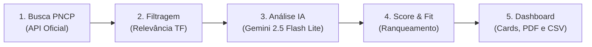

# TechBridge Brasil — Agente Autônomo de Licitações Públicas

Sistema inteligente para busca, filtragem e análise de adequação comercial de editais públicos do **PNCP (Portal Nacional de Compras Públicas)**, desenvolvido especificamente para intermediadoras de tecnologia.

---

## 🎯 Sobre o Projeto

A **TechBridge Brasil** é uma empresa intermediadora de tecnologia que comercializa, implementa e presta serviços para soluções enterprise de grandes fabricantes, como **Microsoft, Oracle, IBM, SAP, Dell, Cisco, Fortinet**, entre outros.

O **Agente de Licitações** atua de forma autônoma:
1. Conecta-se à API pública do governo federal (PNCP).
2. Localiza oportunidades em aberto conforme termos ou categorias de tecnologia.
3. Aplica um pré-filtro de relevância para eliminar editais fora do escopo corporativo.
4. Analisa os termos de referência com Inteligência Artificial (Google Gemini) em baixa temperatura (0.1) para evitar alucinações.
5. Produz um **score de adequação (0 a 100)**, pontos fortes, riscos contratuais, justificativa e uma **estratégia de pitch comercial personalizada**.
6. Apresenta os resultados em um painel web interativo com acompanhamento do fluxo em tempo real via **Server-Sent Events (SSE)**.

---

## 🏗️ Arquitetura e Pipeline de Análise

O agente opera em um pipeline transparente de 5 etapas:



1. **Busca PNCP:** Consulta o endpoint de busca textual do PNCP (`https://pncp.gov.br/api/search/`), recuperando metadados, valores de itens e prazos de propostas.
2. **Filtragem de Relevância:** Avalia a densidade de termos do portfólio da empresa (`empresa.json`), descartando compras fora de foco (obras, fardamentos, merenda) antes de gastar recursos de IA.
3. **Análise com IA (Gemini):**
   - Utiliza prioritariamente o modelo `gemini-2.5-flash-lite` com formato de saída JSON estrito.
   - Possui lista de fallback entre modelos (`gemini-2.5-flash-lite` → `gemini-flash-lite-latest` → `gemini-flash-latest` → `gemini-2.5-flash`).
   - Camada de contingência heurística: caso a cota do Google seja atingida, o sistema gera a análise estruturada sem interrupção.
4. **Score & Fit:** Ranqueia as oportunidades por adequação comercial e alinhamento de margem.
5. **Persistência e Apresentação:** Salva os dados no banco SQLite local (`banco.db`) e disponibiliza relatórios para download em **CSV** e **PDF**.

---

## 🛠️ Tecnologias Utilizadas

O projeto adota exclusivamente bibliotecas e ferramentas **100% gratuitas e de código aberto**:

- **Backend:** Python 3.10+, FastAPI, Uvicorn, HTTPX, ReportLab.
- **Inteligência Artificial:** Google Generative AI SDK (Gemini Free Tier).
- **Banco de Dados:** SQLite (nativo do Python, sem necessidade de servidores externos).
- **Frontend:** HTML5 semântico, JavaScript Vanilla, Tailwind CSS, Lucide Icons.
- **Comunicação em Tempo Real:** Server-Sent Events (SSE).

---

## 📋 Pré-requisitos

- **Python 3.10 ou superior** instalado na máquina.
- **Chave de API do Google Gemini** (gratuita através do [Google AI Studio](https://aistudio.google.com/)).

---

## 🚀 Passo a Passo de Execução

### 1. Clonar ou Acessar a Pasta do Projeto

Abra o terminal (PowerShell, Bash ou Prompt de Comando) na pasta raiz do projeto:

```bash
cd caminho/para/agente-licitacoes
```

---

### 2. Criar e Ativar o Ambiente Virtual

Recomenda-se o uso de um ambiente virtual para isolar as dependências:

**No Windows (PowerShell):**
```powershell
python -m venv venv
.\venv\Scripts\Activate.ps1
```

**No Linux/macOS:**
```bash
python3 -m venv venv
source venv/bin/activate
```

---

### 3. Instalar as Dependências

Instale todos os pacotes necessários listados no `requirements.txt`:

```bash
pip install -r requirements.txt
```

---

### 4. Configurar a Chave de API

Copie o arquivo `.env.exemplo` para `.env`:

**No Windows (PowerShell):**
```powershell
Copy-Item .env.exemplo .env
```

**No Linux/macOS:**
```bash
cp .env.exemplo .env
```

Abra o arquivo `.env` em seu editor de preferência e insira a sua chave obtida no Google AI Studio:

```env
GEMINI_API_KEY=sua_chave_aqui
```

---

### 5. Iniciar o Servidor

Execute o servidor com recarregamento automático ativado:

```bash
python -m uvicorn main:app --host 127.0.0.1 --port 8000 --reload
```

---

### 6. Acessar o Dashboard

Abra seu navegador e acesse:

👉 **[http://127.0.0.1:8000](http://127.0.0.1:8000)**

---

## 💻 Como Usar o Dashboard

1. **Buscar Oportunidades:**
   - Digite um termo de tecnologia no campo de busca (ex.: `Oracle`, `Microsoft`, `IBM`, `Nuvem`, `Cibersegurança`).
   - Opcionalmente, defina valores mínimos e máximos (em R$).
   - Clique em **"Buscar Oportunidades"**.

2. **Acompanhar o Pipeline:**
   - O diagrama no topo da tela indicará o progresso de cada etapa em tempo real.

3. **Filtrar por Score:**
   - Utilize o seletor deslizante (slider) na barra lateral para filtrar os cards exibidos de acordo com a pontuação mínima desejada.

4. **Ver Análise Completa (Slide-over Drawer):**
   - Clique em qualquer card de licitação para abrir o painel lateral com o resumo executivo, pontos fortes, riscos, estratégia de pitch e o link direto para o edital no PNCP.

5. **Exportar Resultados:**
   - Clique no botão **CSV** para baixar uma planilha formatada com todas as oportunidades identificadas.
   - Clique no botão **PDF** para baixar um relatório técnico e executivo formatado para impressão ou apresentação.

6. **Gerenciar Histórico:**
   - Clique em qualquer item do **Histórico Recente** para repetir a busca rapidamente.
   - Clique no botão **"Limpar"** para esvaziar o histórico salvo no banco.

---

## 📁 Estrutura de Pastas

```
agente-licitacoes/
├── agente/
│   ├── analisador.py          # Orquestrador do fluxo e emissão de eventos SSE
│   ├── buscador.py            # Consulta à API pública do PNCP e cálculo de itens
│   └── classificador.py       # Integração com Gemini, controle de cota e fallbacks
├── api/
│   └── rotas.py               # Endpoints REST e streaming SSE da FastAPI
├── frontend/
│   ├── index.html             # Interface do dashboard (Tailwind CSS + Lucide Icons)
│   ├── app.js                 # Lógica de conexão, renderização de cards e drawer
│   └── style.css              # Regras de animação, transições e estados de loading
├── modelos/
│   └── schemas.py             # Modelos de dados e contratos (Dataclasses)
├── utils/
│   ├── banco.py               # Persistência local em SQLite (buscas e análises)
│   ├── exportador.py          # Gerador de planilhas CSV e relatórios PDF (ReportLab)
│   └── filtro_relevancia.py   # Pré-filtro semântico e cálculo de aderência
├── empresa.json               # Perfil corporativo da TechBridge Brasil
├── main.py                    # Ponto de entrada da aplicação FastAPI
├── requirements.txt           # Dependências Python do projeto
├── .env.exemplo               # Modelo de configuração da variável de ambiente
└── README.md                  # Documentação do projeto
```

---

## 🛡️ Princípios de Código

- **KISS & YAGNI:** Código direto, limpo e legível por desenvolvedores juniores, sem complexidade desnecessária.
- **Resiliência:** Tolerância a falhas na rede governamental (PNCP) e gestão inteligente de cotas gratuitas de IA.
- **Zero Custo:** Nenhuma biblioteca ou serviço pago é necessário para a execução integral da aplicação.

  ## Observações

  - Nós usamos Antigravity como harness e o modelo Gemini 3.8 Flash no High effort para a criação da solução.
  - Usamos Claude Opus 5.5 para a criação dos slides da nossa apresentação.
